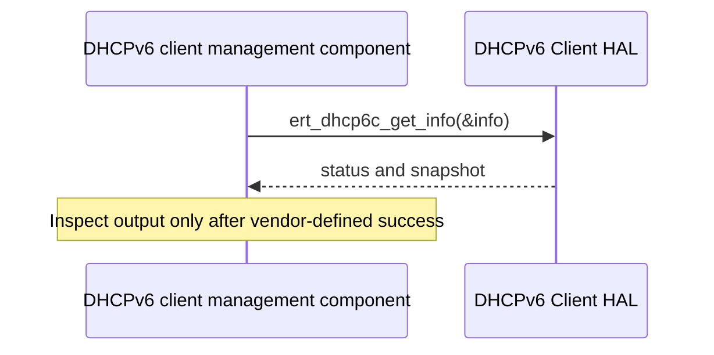

# DHCPv6 Client HAL Specification

## Version History

| Date | Comment | Version |
| --- | --- | --- |
| — | Documentation alignment; no ABI change. | — |

## Acronyms
HAL means Hardware Abstraction Layer; DHCP means Dynamic Host Configuration Protocol; ECM means Embedded Cable Modem.

## Description
The DHCPv6 client management component retrieves E-Router and ECM client snapshots through this HAL.

## Optional Components
E-Router and ECM availability depends on the product.

## Component Runtime Execution Requirements
### Initialization and Startup
The platform must provide the underlying client before querying snapshots.
### Threading Model
Serialize access unless the vendor explicitly guarantees concurrency.
### Process Model
These are in-process calls into the product implementation.
### Memory Model
The caller owns the writable snapshot structure. Use output only after success, treat IPv6 addresses as binary data, and validate returned counts against array capacity before iteration.
### Asynchronous Notification Model
Obtain a new snapshot when required.
### Internal Error Handling
Both calls return `int`. Comments name `STATUS_SUCCESS` and `STATUS_FAILURE`, but this header defines neither numeric value. Confirm the vendor mapping; do not assume zero and minus one from another HAL.
### Persistence Model
The getters do not establish persistence or modify client configuration.

## Nonfunctional Requirements
### Logging and Debugging
Implementations must not log credentials, secrets, security-sensitive information, or other sensitive data. Log operation outcomes rather than payloads.
### Quality Control
Check buffer boundaries, DNS counts, client-unavailable cases, and snapshot consistency. Use static analysis and memory tools.
### Licensing
See repository Apache-2.0 notices.
### Build Requirements
Include `dhcp6cApi.h` and link the product's DHCPv6 HAL implementation; legacy packaging identifies `libdhcp6cApi.so`.
### Variability Management
Do not infer availability of both clients on every device.

## Interface API Documentation
| Function | Arguments and behavior |
| --- | --- |
| `int ert_dhcp6c_get_info(dhcp6cInfo_t *pInfo)` | Writes the E-Router client snapshot into caller storage. |
| `int ecm_dhcp6c_get_info(dhcp6cInfo_t *pInfo)` | Writes the ECM client snapshot into caller storage. |

### Theory of Operation and Key Concepts
The snapshot includes client state, configuration attempts, addresses, lease timers, and DNS servers. Interpret timer units and state values using the product implementation.

### Sequence Diagram

## Source References
- [dhcp6cApi.h](https://github.com/rdkcentral/rdkb-halif-dhcp6c/blob/develop/include/dhcp6cApi.h)
